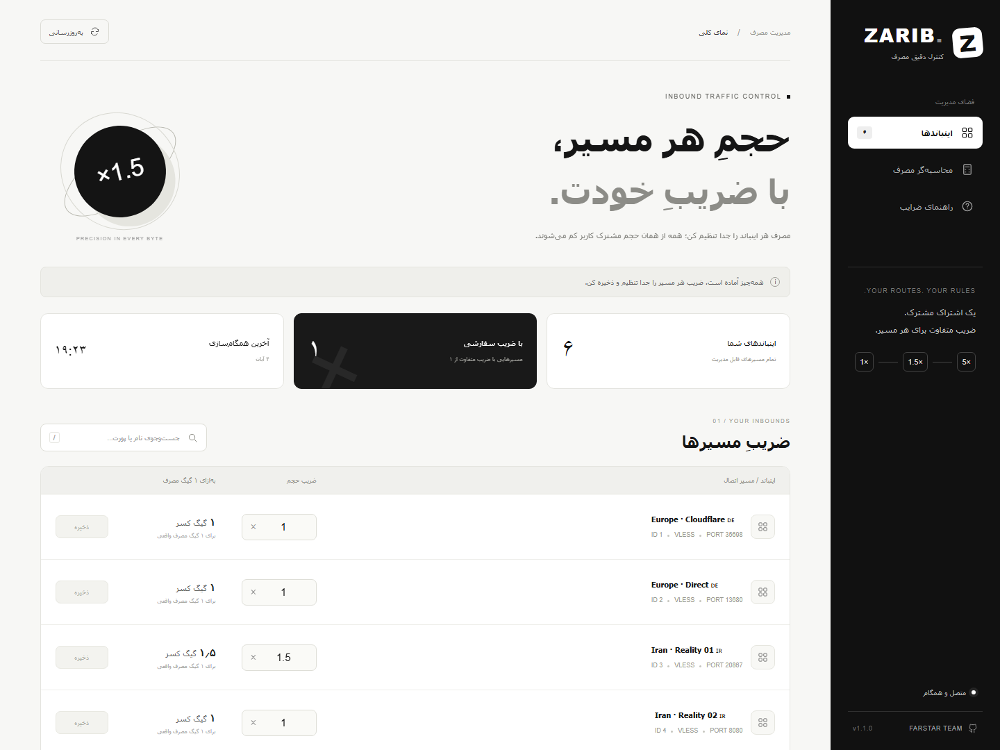

<div align="center">

# ZARIB.

### هر مسیر، ضریب خودش.

**مدیریت مستقل ضریب مصرف اینباندهای 3x-ui**

سفید و مشکی · فارسی و راست‌به‌چپ · مناسب موبایل · نصب با یک دستور

[نصب](#نصب-با-یک-دستور) · [روش محاسبه](#روش-محاسبه) · [سازگاری](#سازگاری) · [English](README.en.md)



</div>

## نصب با یک دستور

روی سروری که **پنل ثنایی و Xray در حال اجراست**، با کاربر root اجرا کنید:

```bash
bash <(curl -fsSL https://raw.githubusercontent.com/farstar-team/zarib-3x-ui/main/install.sh)
```

نصب‌کننده، تنظیمات پنل، بانک اطلاعاتی، دامنه، پورت و مسیر ورود را پیدا می‌کند و در پایان **آدرس ZARIB** را نمایش می‌دهد. پورت پیش‌فرض اولین گزینهٔ آزاد میان **۲۰۸۷، ۲۰۸۳ و ۲۰۵۴** است. تنظیمات خاص را می‌توان با گزینه‌های پایین مشخص کرد.

ابتدا در همان مرورگر و با همان دامنه وارد پنل ثنایی شوید؛ سپس آدرس نمایش‌داده‌شدهٔ ZARIB را باز کنید. افزونه از نشست ورود همان پنل استفاده می‌کند و رمز تازه‌ای برای مدیریت نمی‌سازد. لینک برگشت به پنل در رابط ZARIB وجود ندارد.

**نصب مجدد و به‌روزرسانی:** همین دستور را دوباره اجرا کنید. ضرایب و مصرف ذخیره‌شده حفظ می‌شوند. سرویس خود افزونه به‌روزرسانی می‌شود؛ نصب‌کننده فرمانی برای ری‌استارت ثنایی یا Xray اجرا نمی‌کند.

## روش محاسبه

**نسخهٔ ۱٫۱٫۱:** تغییر دوبارهٔ ضریب در پنل‌هایی که آمار را تجمعی می‌خوانند، مصرف قبلی را دوباره قیمت‌گذاری نمی‌کند. برای نمونه، پس از ۱۰۰ واحد مصرف با ضریب ۱٫۵، تغییر به ضریب ۲ همچنان مصرف قبلی را ۱۵۰ نگه می‌دارد؛ ۵۰ واحد مصرف تازه، ۱۰۰ واحد دیگر اضافه می‌کند. مرز تغییر در بانک مستقل افزونه ذخیره می‌شود و بعد از ری‌استارت هسته به نسل قبلیِ شمارنده اعمال نمی‌شود.

حجم اشتراک یک حساب مشترک است؛ هر مسیر، ضریب خودش را دارد:

| مسیر | مصرف واقعی | ضریب | کسر از حجم اشتراک |
|---|---:|---:|---:|
| مسیر اول | ۲ گیگ | ۱٫۵ | ۳ گیگ |
| مسیر مستقیم | ۲ گیگ | ۱ | ۲ گیگ |
| مسیر سوم | ۱ گیگ | ۵ | ۵ گیگ |

آپلود و دانلود همان اینباند محاسبه می‌شوند. ضریب یک مسیر روی مصرف مسیرهای دیگر اثر ندارد. تمام اینباندها در نصب تازه با **ضریب ۱** شروع می‌شوند.

- ضریب **۰**: مصرف تازهٔ مسیر رایگان است.
- ضریب **۰٫۵**: هر یک گیگ مصرف، نیم گیگ از اشتراک کم می‌کند.
- ضریب **۱**: کسر برابر با مصرف واقعی.
- ضریب **۱٫۵**: هر دو گیگ مصرف، سه گیگ کسر.
- بازهٔ قابل تنظیم: **۰ تا ۱۰، حداکثر سه رقم اعشار**.

**شروع اعمال ضریب:** اولین فعال‌سازی ضریب سفارشی هر اینباند، برای اتصال‌های تازه است و آماده‌شدنش حدود ۵ ثانیه زمان می‌برد. اتصال‌های باز قبلی تا اتصال مجدد طبیعی با ضریب ۱ ادامه دارند. تغییرهای بعدی ضریب در نوبت بعدی ثبت مصرف اعمال می‌شوند. افزونه اتصال‌های باز را برای این کار قطع نمی‌کند.

مصرف قبلی، سقف اشتراک، تاریخ انقضا و UUID کاربران تغییر نمی‌کند. آمار فیزیکی سرور و اینباند هم ضریب نمی‌خورد؛ ضریب برای کسر حجم حساب کاربر است.

## امکانات

- ضریب مستقل برای هر اینباند VLESS، حتی با حساب مشترک بین چند اینباند.
- جست‌وجو با نام، شناسه یا پورت، با پشتیبانی از رقم‌های فارسی.
- ذخیرهٔ مستقل هر ردیف؛ تغییرهای ذخیره‌نشده با تازه‌کردن اطلاعات حفظ می‌شوند.
- محاسبه‌گر مصرف برای آزمایش ضریب، بدون تغییر تنظیمات واقعی.
- رابط سفید و مشکی، راست‌به‌چپ و واکنش‌گرا.
- نگهداری دقیق کسر بایت‌ها برای ضرایب اعشاری.
- احراز هویت با نشست ثنایی و بررسی دسترسی همان کاربر به اینباند.
- نصب و به‌روزرسانی مستقل از فایل‌های رسمی ثنایی، همراه با پشتیبان و برگشت در صورت خطا.

<details>
<summary>نمای موبایل</summary>


</details>

## سازگاری

این افزونه جایگزین پنل یا هستهٔ VPN نیست. نصب معمول برای **Debian 12+ و Ubuntu 22.04+ با systemd**، Python 3.10+ و نصب بومی 3x-ui طراحی شده است.

- بانک **SQLite** در حالت فقط‌خواندنی پشتیبانی می‌شود.
- **PostgreSQL محلی** با ساخت نقش خواندنیِ محدود به پنج ستون فهرست اینباندها پشتیبانی می‌شود. PostgreSQL داخل کانتینر یا روی میزبان دیگر به تنظیم جداگانه نیاز دارد و در نصب خودکار پوشش داده نشده است.
- درگاه مدیریتی IPv4 محلی Xray با `HandlerService` و `StatsService` و پشتیبانی از `GetInboundUsers` لازم است. نصب‌کننده قبل از تغییر سرویس این رابط را بررسی می‌کند.
- این نسخه اینباندهای **VLESS** را پشتیبانی می‌کند.
- برای پنل HTTPS از گواهی موجود همان پنل استفاده می‌شود. پنل HTTP، رابط HTTP می‌گیرد؛ نصب‌کننده برای دامنه گواهی جدید صادر نمی‌کند.
- اگر پنل پشت پراکسی معکوس یا در مسیر/میزبان غیرمعمول است، تنظیم خودکار را قبل از استفاده بررسی کنید. دامنهٔ بازشده برای ورود و ZARIB باید یکسان باشد.
- قانون مسیریابی بر اساس ایمیل کاربر با نام‌گذاری داخلی این روش تداخل دارد؛ در صورت وجود چنین قانونی، ذخیرهٔ ضریب تازه متوقف می‌شود.

**تأیید شده با 3x-ui 3.11.0 و Xray 26.10.21.** نصب تازه و ارتقا روی یک پنل SQLite و هستهٔ مستقل آزمایش شده؛ محاسبهٔ دقیق حساب مشترک نیز روی پنل PostgreSQL بررسی شده است. سازگاری همهٔ نسخه‌های آینده تضمین نمی‌شود؛ تغییر ناسازگار رابط رسمی می‌تواند به به‌روزرسانی افزونه نیاز داشته باشد.

## تنظیمات اختیاری

برای انتخاب دامنه و پورت:

```bash
bash <(curl -fsSL https://raw.githubusercontent.com/farstar-team/zarib-3x-ui/main/install.sh) --host panel.example.com --web-port 2087
```

برای بانک SQLite با مسیر متفاوت:

```bash
bash <(curl -fsSL https://raw.githubusercontent.com/farstar-team/zarib-3x-ui/main/install.sh) --panel-db /path/to/x-ui.db
```

برای بررسی سازگاری بدون تغییر فایل، ضریب یا سرویس:

```bash
bash <(curl -fsSL https://raw.githubusercontent.com/farstar-team/zarib-3x-ui/main/install.sh) --check
```

گزینه‌های بیشتر با `python3 installer.py --help` در دسترس‌اند. نصب‌کنندهٔ شِل ممکن است بسته‌های موردنیازِ نصب‌نشده را حتی در حالت `--check` نصب کند؛ بررسی Python به خود پنل و سرویس‌های آن دست نمی‌زند.

## نگهداری

| مورد | مسیر پیش‌فرض |
|---|---|
| سرویس | `farstar-inbound-multiplier.service` |
| برنامه | `/opt/farstar-inbound-multiplier/` |
| تنظیمات محرمانه | `/etc/farstar-inbound-multiplier/config.json` |
| ضرایب و باقیماندهٔ اعشاری | `/var/lib/farstar-inbound-multiplier/state.sqlite` |
| پشتیبان‌های نصب و ارتقا | `/var/lib/farstar-inbound-multiplier/backups/` |

```bash
systemctl status farstar-inbound-multiplier
journalctl -u farstar-inbound-multiplier -n 50 --no-pager
```

فایل تنظیمات و پشتیبان‌ها فقط برای root هستند. تنظیم واقعی نصب، بانک مشتریان، کلیدها و رمزها نباید وارد Git شوند.

اگر پنل برای تمام‌شدن حجم حساب، گزینهٔ ری‌استارت Xray را فعال کرده باشد، همان رفتار قبلی ادامه دارد؛ ZARIB آن سیاست را تغییر نمی‌دهد.

**حذف افزونه:** پس از استفاده از ضریب سفارشی، سرویس و قاعدهٔ هدایت مدیریتی را به‌تنهایی پاک نکنید. اتصال‌های باز ممکن است هنوز شمارنده‌های نام‌گذاری‌شده داشته باشند. حذف کامل باید پس از برگشت ضرایب به ۱، ثبت مصرف باقی‌مانده و پاک‌شدن شناسه‌های زمان اجرا در زمان نگهداری انجام شود؛ ممکن است به راه‌اندازی مجدد برنامه‌ریزی‌شدهٔ هسته نیاز داشته باشد. [جزئیات معماری](docs/architecture.md)

## آزمون‌ها

```bash
mkdir -p generated
protoc -I proto --python_out=generated $(find proto -name '*.proto' -printf '%P ')
sudo python3 -m unittest -v test_accounting test_installer
```

آزمون نصب کامل، با سرویس و هستهٔ آزمایشی جدا، روی یک میزبان آزمایشیِ systemd:

```bash
sudo python3 test_installation.py
```

این آزمون نصب تازه، ارتقای مجدد، حفظ ضریب، حفظ اتصال‌های داده و ثابت‌ماندن PID هستهٔ آزمایشی را بررسی می‌کند. کدهای `test_*` برای اجرا در محیط آزمایشی هستند؛ پورت‌های محلی ۶۲۵xx و ۶۲۶xx و دسترسی root می‌خواهند. برای مسیر متفاوت هسته می‌توان متغیر `XRAY_BIN` را تنظیم کرد.

## مجوز

کد افزونه تحت [MIT](LICENSE) منتشر می‌شود. فایل‌های پروتکل Xray بدون تغییر از مرجع مشخص‌شده در [SOURCES.json](proto/SOURCES.json) آمده‌اند و مشمول [مجوز Xray](THIRD_PARTY_LICENSE_Xray-core.txt) هستند.

ساخته‌شده توسط **[Farstar Team](https://github.com/farstar-team)**.
