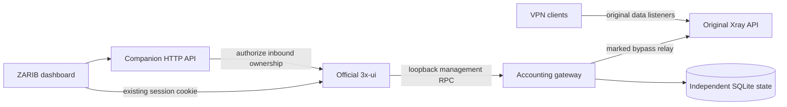

# Architecture and recovery

Customer data sockets are not sent through the Python gateway. A narrow root-owned OUTPUT rule redirects only TCP management connections to the core's discovered loopback port. A marked upstream relay bypasses that exact rule. The service re-establishes it after readiness, and keeps it in place across failures until automatic service recovery, so the panel cannot drain namespaced counters without normalization.

To distinguish traffic from shared accounts, an instrumented inbound's runtime VLESS email is scoped as `irgcoef1.<inbound-id>.<base64url-email>`. Authentication UUID/account/flow are copied unchanged. RemoveUser/AddUser replace authentication metadata without removing the inbound or closing existing data sockets. The gateway restores public emails in management responses and traffic/online statistics before the official panel receives them.

Legacy open connections cannot be attributed to an inbound after the fact because their core counters use the same global email. They remain at factor 1 until natural reconnection. Later factor changes apply at the next stats collection. Instrumentation stays enabled when the factor returns to 1, because old scoped connections can still be active.

Integer milli-factors and persisted fractional byte carry avoid repeated rounding loss. Preview reads never commit carry; reset reads do. Filtered reset queries drain only matching counters. The native panel performs its ordinary shared-quota accounting; no custom triggers or billing columns are added to its database.

SQLite metadata is opened `mode=ro` with `query_only`. Local PostgreSQL gets a random, non-superuser reader role with SELECT only on `inbounds(id,tag,remark,port,protocol)`. No permanent panel-admin token is retained. Browser writes require a valid panel session, authorized inbound, exact Origin and JSON media type.

## Installation and upgrade

The shell bootstrap installs only missing dependencies with service restarts deferred, downloads one complete source archive and validates `SHA256SUMS`. Python discovers and probes the current core before installing. Existing configurations and factors are reused on upgrade. Code/config/service backups and a consistent SQLite backup are created first.

Only the companion service is restarted. The installer fingerprints the original core process/config before and after. If upgrading fails, previous companion code/config/service files are restored; an old accounting database is **never** restored over live billing state. Fresh-install failure removes only its own uninstrumented gateway and its newly provisioned reader role. Concurrent factor edits cause the gateway to be preserved for inspection rather than removed unsafely.

The code does not guarantee exactly-once accounting across every possible machine failure: the original core's resettable counters, the companion's SQLite commit and the panel's own database commit are separate operations. Normal reads, fractional arithmetic and shared-account aggregation are tested; power loss during a reset/commit window can still lose a collection, as with other reset-counter accounting paths.

## Backup and planned removal

Back up root-only config/service files and use `sqlite3.Connection.backup` for a live state database. Copying only the main `.sqlite` file while WAL is active is insufficient.

Do not remove the redirect independently after any inbound is instrumented. A planned removal needs factors restored to 1, final counters collected by the panel, reconciliation disabled and runtime scoped users cleared. A controlled core restart in a maintenance window can clear those runtime identities. Stopping the gateway first can lose usage attribution or leave management operations unavailable.

The upstream core restart-on-client-disable policy, routing, DNS, customer credentials and normal panel updater remain under the official panel's control. Future incompatible API/schema changes require review rather than silently modifying upstream binaries.
